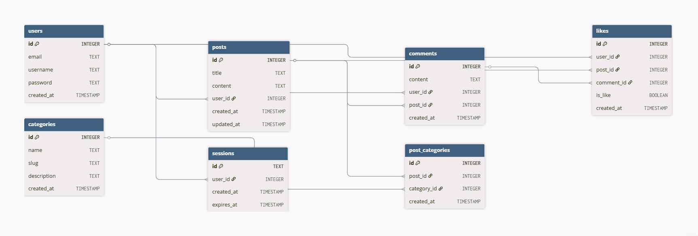

# Book Forum – Bookies
Bookies is an intuitive forum platform where book enthusiasts can discuss literature, share insights and engage in meaningful conversations with fellow readers.

## 1. Summary
### Current situation:

The "Literary Lions" book club was drowning in paper-based discussions that created chaos and confusion. Sticky notes overflowed pages, comments got lost in scribbles and finding past insights felt like navigating a literary labyrinth. New members felt intimidated by the chaotic paper trails, hindering their engagement and knowledge sharing.
The challenge was to design a digital forum that tames the paper pandemonium and fosters a thriving online book club community.

### Solution:
Literary Lions Forum addresses these needs by providing a comprehensive digital platform that transforms chaotic paper discussions into organized, accessible conversations. The solution includes:

- User authentication system with secure registration and login
- Comprehensive post and comment system for rich discussions
- Category-based organization for different books, genres, and topics
- Like/dislike functionality to highlight valuable contributions
- Advanced filtering capabilities for easy content discovery
- Responsive design optimized for all devices
- SQLite database for reliable data management
- Dockerized deployment for easy setup and scalability

## 2. Code Structure
```
literary-lions/
├── cmd/
│   └── main.go                          # Application entry point
├── internal/
│   ├── data/
│   │   ├── books.go                     # Book data structures
│   │   └── quotes.go                    # Quote data structures
│   ├── database/
│   │   └── database.go                  # Database connection & setup
│   ├── handlers/
│   │   ├── auth_handler.go              # Login, register, logout handlers
│   │   ├── comment_handler.go           # Comment creation & management
│   │   ├── darkmode_handler.go          # Dark mode toggle functionality
│   │   ├── error_handler.go             # 404 & 500 error pages
│   │   ├── page_handler.go              # Home page & basic pages
│   │   ├── post_handler.go              # Forum, posts, & new post creation
│   │   ├── user_handler.go              # User profile management
│   │   └── vote_handler.go              # Like/dislike voting system
│   ├── middleware/
│   │   └── recovery.go                  # Error recovery middleware
│   ├── models/
│   │   ├── books.go                     # Book model definitions
│   │   ├── category.go                  # Category model definitions
│   │   ├── comment.go                   # Comment model definitions
│   │   ├── like.go                      # Like/vote model definitions
│   │   ├── post.go                      # Post model definitions
│   │   ├── quote.go                     # Quote model definitions
│   │   ├── session.go                   # Session model definitions
│   │   └── user.go                      # User model definitions
│   ├── repository/
│   │   └── sqlite/
│   │       ├── books_repository.go      # Book database operations
│   │       ├── category_repository.go   # Category database operations
│   │       ├── comment_repository.go    # Comment database operations
│   │       ├── like_repository.go       # Like/vote database operations
│   │       ├── post_repository.go       # Post database operations
│   │       ├── quote_repository.go      # Quote database operations
│   │       ├── session_repository.go    # Session database operations
│   │       └── user_repository.go       # User database operations
│   │   ├── books_repository.go          # Book repository interface
│   │   └── category_repository          # Category repository interface
│   └── utils/
│       ├── password.go                  # Password hashing utilities
│       └── session.go                   # Session management utilities
├── media/
│   ├── books/                           # Book cover images
│   ├── blob.png                         # UI decoration images
│   ├── blob2.png
│   ├── blob3.png
│   ├── blob7.png
│   ├── error.png                        # Error page graphics
│   ├── favicon.png                      # Website favicon
│   ├── logo.png                         # Brand logos
│   ├── logo2.png
│   ├── logo2_darkmode.png              # Dark mode logo variants
│   ├── logo_simple.png
│   ├── profile_avatar.png              # Default user avatars
│   ├── user_logo.png                   # User-specific logos
│   ├── user_logo2.png
│   └── user_logo2_darkmode.png         # Dark mode user logos
├── templates/
│   ├── error404.html                   # 404 error page
│   ├── error500.html                   # 500 error page
│   ├── footer.html                     # Site footer template
│   ├── forgot_password.html            # Password recovery page
│   ├── forum.html                      # Main forum listing
│   ├── header.html                     # Guest header template
│   ├── home.html                       # Homepage template
│   ├── login.html                      # User login page
│   ├── postview.html                   # Individual post view
│   ├── register.html                   # User registration page
│   ├── user_header.html                # Logged-in user header
│   ├── user_newpost.html               # New post creation form
│   └── user_profile.html               # User profile page
├── web/
│   └── static/
│       ├── darkmode.css                # Dark/light mode styling
│       ├── error.css                   # Error page styles
│       ├── footer.css                  # Footer styling
│       ├── forum.css                   # Forum page styles
│       ├── header.css                  # Header styling
│       ├── home.css                    # Homepage styles
│       ├── login.css                   # Login/register page styles
│       ├── mainstyle.css               # Global styles
│       ├── newpost.css                 # New post form styles
│       ├── postview.css                # Post detail page styles
│       ├── profile.css                 # User profile styles
│       ├── register.css                # Registration form styles
│       └── reset.css                   # CSS reset styles
├── .gitignore                          # Git ignore rules
├── database_erd.md                     # Database schema documentation
├── Dockerfile                          # Docker container configuration
├── forum.db                            # SQLite database file
├── go.mod                              # Go module dependencies
├── go.sum                              # Go module checksums
├── README.md                           # Project documentation
└── test_404.sh                         # Testing script
```

## 3. Installation
### Quick Start

Clone the repository
```
bash
git clone <https://gitea.kood.tech/helisavila/literary-lions>
cd literary-lions
```

### Build and run with Docker (Recommended) 
If you don't have Docker installed, download and install it from:
- [Windows: Docker Desktop for Windows](https://desktop.docker.com/win/main/amd64/Docker%20Desktop%20Installer.exe)
- [Mac: Docker Desktop for Mac](https://desktop.docker.com/mac/main/amd64/Docker.dmg)
- [Linux: Docker Engine](https://docs.docker.com/engine/install/)

```
docker build -t literary-lions .  
docker run -v $(pwd):/host -p 8080:8080 literary-lions
```
### Access the application
Open your browser and navigate to http://localhost:8080

## 4. Features
- User Authentication
- Post Management
- Comment System
- Like/Dislike System
- Category Organization and filtering posts
- Error Handling

## 5. Bonus features (for review)
- User Profiles: personal dashboards showing user activity
- Search tab
- Sorting feature: sort posts by recent, most liked, most disliked
- Dark/Light Mode: Complete theme switching with persistent user preferences (cookie-based storage)
- Responsive Design: optimized for desktop and mobile devices

## 6. Technical Stack
- Backend: Go (Golang) with net/http
- Database: SQLite with go-sqlite3 driver
- Frontend: HTML templates with CSS styling
- Containerization: Docker for deployment
- Session Management: Cookie-based with UUID tokens
- Security: bcrypt password hashing

## 7. Database Schema



## 8. Credits & Attributions
#### Fonts
- Logo font: [Barriecito - Copyright 2018 The Barriecito Project Authors](https://fonts.google.com/specimen/Barriecito)
- Main font: [Hepta Slab - Copyright 2018 The Hepta Slab Project Authors](https://fonts.google.com/specimen/Hepta+Slab)

#### Search bar icon
- [Bharat Icons - Flaticon](https://www.flaticon.com/free-icons/search-bar)

#### Photos and images used:
- [Lion - Unsplash](https://www.flaticon.com/free-icon/lion_490125) 
- [Plant - Unsplash](https://www.flaticon.com/free-icon/succulent_3968246) 
- [Plant2 - Unsplash](https://www.flaticon.com/free-icon/alocasia_6670600)
- [Books - Unsplash](https://www.flaticon.com/free-icon/book-stack_3389066)
- [Blobs – Muhammad Abdullah – Freepik](https://www.freepik.com/free-vector/colorful-abstract-fluid-handdrawn-organic-creative-blob-shapes-element_381357218.htm#fromView=keyword&page=1&position=19&uuid=6d9b47bf-4bde-4289-a23c-c517641187c5&query=Blob) 

## Authors
- [Heli Savila](https://gitea.kood.tech/helisavila) Frontend Development, UI/UX Design
- [Ibrahim Sen](https://gitea.kood.tech/ibrahimsen) Backend Development, Architecture, Docker Implementation

